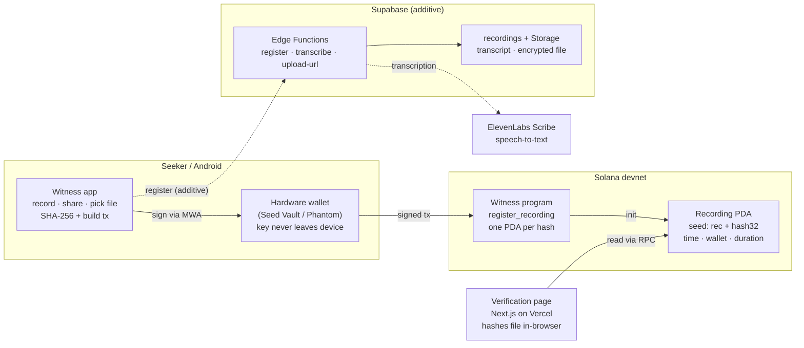

# Witness

**A mobile notary for media. Seal any photo, audio, video or document on Solana and let anyone prove it hasn't changed since.**

Witness takes the raw bytes of a file, computes its SHA‑256 fingerprint, and has the user sign an on‑chain record with their hardware wallet (Seed Vault / Phantom via Mobile Wallet Adapter). The file itself never leaves the phone. Later, anyone can drop the same file into a public web page that re‑hashes it in the browser and checks the chain:

> **✅ identical to the sealed record** — or — **❌ never sealed / modified since.**

> Witness does **not** prove a file is *true*. It proves that a specific file existed at a specific time and has **not been altered since it was sealed**. That distinction is the whole product.

---

## What it proves (and what it doesn't)

| Claim | Provable? | Backed by |
| --- | --- | --- |
| This file existed no later than time *T* | ✅ Yes | Solana block time (`anchored_at`) |
| Not a single byte has changed since *T* | ✅ Yes | SHA‑256 match |
| This wallet sealed it | ✅ Yes | Ed25519 transaction signature |
| It came from a genuine Seeker device | 🟡 Strong hint | Seeker Genesis Token in the wallet |
| It was captured at location *L* | 🟡 Claim only | Phone GPS, not cryptographic |
| The *content* is real / unstaged | ❌ No | You can hold a speaker to a mic. We say "unaltered", never "true" |

## Live & on‑chain

- **Verification site:** https://web-pi-cyan-30.vercel.app (hashes in your browser, reads straight from Solana RPC — you don't have to trust us)
- **Program (devnet):** [`2CyjSQFX9pSJV7uTVG8UwvGxeDuRQyWZrfHMd8FZeeYJ`](https://explorer.solana.com/address/2CyjSQFX9pSJV7uTVG8UwvGxeDuRQyWZrfHMd8FZeeYJ?cluster=devnet)
- **Status:** full flow proven end‑to‑end on devnet — audio recordings and shared/picked photos sealed, then independently re‑verified (browser hash + `getAccountInfo` on the PDA, byte‑for‑byte match).

## How it works

Critical path: **app → hardware wallet → program → PDA ← verification page.** Supabase and ElevenLabs (dashed) are additive — if they go down, sealing and verification still work, because the proof lives entirely on‑chain.



## Three ways to seal — one proven path

Every entry point copies the file untouched and flows into the exact same seal pipeline (`hash → wallet approval → register_recording`):

1. **Record** — capture audio in‑app (m4a / AAC, mono, 44.1 kHz).
2. **Share** — "Share → Witness" from any app (gallery, camera, recorder, Files). Photos, video, audio, PDF.
3. **Pick a file** — "Seal an existing file" opens the system picker for any media. Share‑sheet‑independent, so it works reliably even on stage.

## Verify it yourself

```bash
# 1. Hash the original file (must equal the on-chain record)
shasum -a 256 your-file

# 2. Open the verification site and drop the SAME file in
#    → ✅ shows anchored time, wallet, duration
#    → change one byte and re-drop → ❌ "never sealed / modified"
```

The phone, the browser, and `shasum -a 256` all produce the **same** lowercase‑hex SHA‑256 for the same bytes — that cross‑check is the heart of the system.

## Interface contracts

| Topic | Rule |
| --- | --- |
| Hash | SHA‑256 of the file's final raw bytes. Lowercase hex (64 chars) in text, 32 bytes on chain. After sealing the file is **never** re‑encoded, trimmed, or re‑tagged |
| Program | Devnet, `WITNESS_PROGRAM_ID` + `program/target/idl/witness.json`. PDA seeds `["rec", hash32]` — content‑addressed, one record per hash |
| Time | Unix seconds (`i64`) on chain; UI shows local time |
| Share link | `/v/<hash>` + optional `#k=<key>`; Memo fallback adds `?tx=<signature>` |
| Memo format | `witness:v1:<hash hex>` (SPL Memo fallback if the program is ever unavailable) |
| Privacy | Only the hash, timestamp, duration, and an optional location **commitment** go on chain. Audio, transcript, and raw coordinates **never** touch the chain |
| Secrets | ElevenLabs and Supabase service keys live only in Supabase secrets; the repo ships only `.env.example` |

## Repository

| Folder | Contents |
| --- | --- |
| [`/app`](app) | React Native + Expo **dev build** (Solana Mobile template): UI, recording, MWA + hardware‑wallet signing, hash |
| [`/program`](program) | Anchor program (`register_recording`), tests, IDL |
| [`/web`](web) | Next.js verification page (`/`, `/v/<hash>`), deployed on Vercel |
| [`/supabase`](supabase) | SQL migrations + Edge Functions (`register`, `transcribe`, `upload-url`) |
| [`/docs`](docs) | Technical deep‑dive + fallback spec (and internal team‑planning docs, in Turkish) |

**Tech stack:** React Native / Expo dev build · Mobile Wallet Adapter · `@solana/web3.js` 1.x · Anchor 0.31.x (Rust) · Next.js · Supabase (Postgres + Edge Functions + Storage) · ElevenLabs Scribe.

## Quick start

```bash
git clone https://github.com/GTU-Blockchain/witness_dev3pack2026.git
cd witness_dev3pack2026
cp .env.example .env   # fill in values; .env is never committed
```

Each folder's own README has setup steps. Deep dive: [`docs/TEKNIK_DOKUMAN.md`](docs/TEKNIK_DOKUMAN.md).

## Why Solana Mobile

The private key lives in Seed Vault / the hardware wallet and never leaves the device; every seal is an explicit, biometric‑gated approval. Mobile Wallet Adapter makes third‑party in‑app signing possible, fees are negligible on devnet, and **anyone** can verify permissionlessly from a browser — no account, no gatekeeper.
