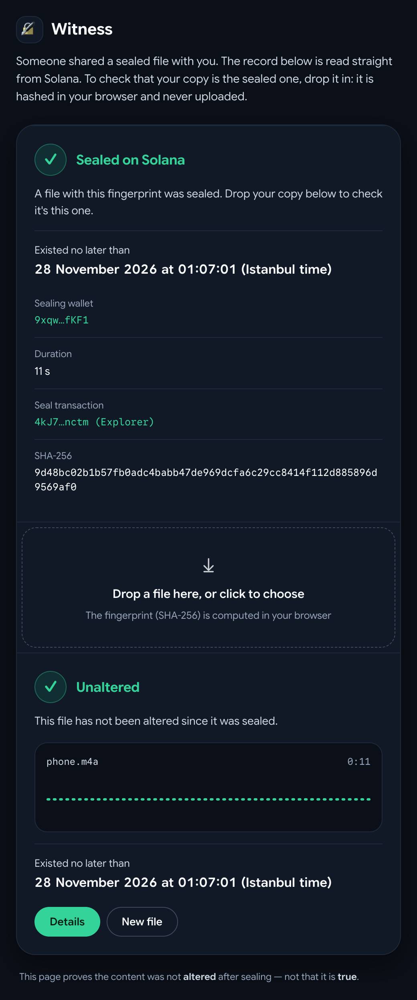
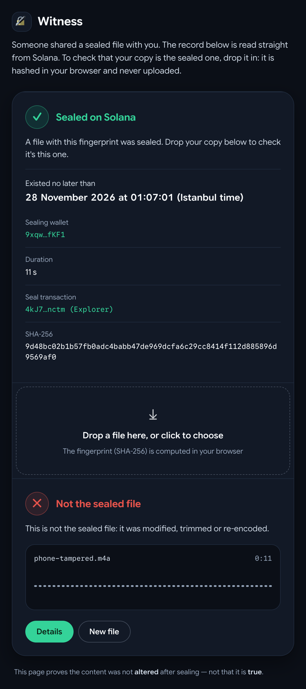
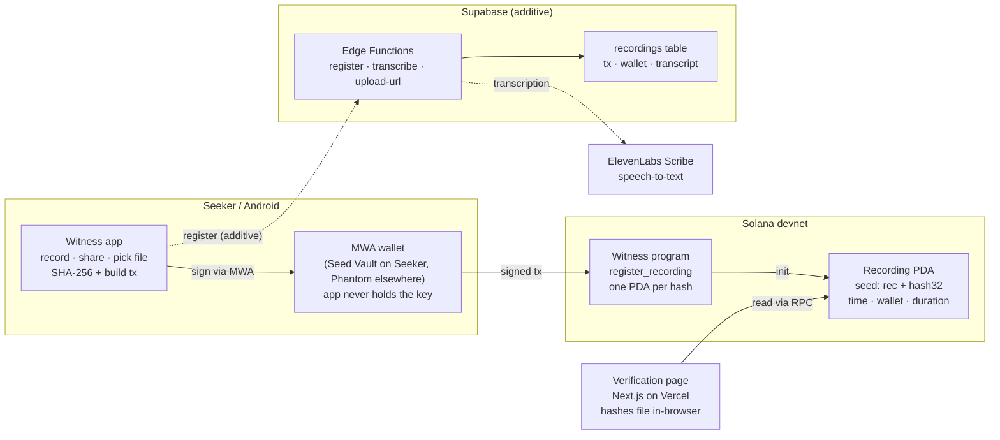

# Witness

[](https://github.com/GTU-Blockchain/witness_dev3pack2026/actions/workflows/ci.yml)

**Witness is a mobile app for people whose photos and recordings get questioned (tenants, journalists, insurance claimants) that seals a file's fingerprint on Solana, so anyone can later prove it hasn't changed.**

**[Pitch deck](docs/Witness_Pitch.pdf)** (PDF, 14 slides) · **[Demo video](https://youtu.be/3xsx3oWeymk)** · **[Live verifier](https://web-pi-cyan-30.vercel.app)** · **[X: @witness_sol](https://x.com/witness_sol)**

## Problem

A tenant films the flat at move-out to show it was left clean and undamaged. Months later the landlord keeps
the deposit and says the video was edited or recorded later. The tenant has the file, but no simple way to show
it is the original, untouched recording from that day, so the dispute comes down to whose word is believed.

## What Witness does

Witness takes the raw bytes of a file, computes its SHA‑256 fingerprint, and has the user sign an on‑chain record through Mobile Wallet Adapter (Seed Vault on a Seeker, Phantom elsewhere; the app never holds a key). The file itself never leaves the phone. Later, anyone can drop the same file into a public web page that re‑hashes it in the browser and checks the chain:

> **✅ identical to the sealed record** — or — **❌ never sealed / modified since.**

> Witness does **not** prove a file is *true*. It proves that a specific file existed at a specific time and has **not been altered since it was sealed**. That distinction is the whole product.

## For judges

- **APK:** [`witness-v1.0.2-hackathon.apk`](https://github.com/GTU-Blockchain/witness_dev3pack2026/releases/download/v1.0.2-hackathon/witness-v1.0.2-hackathon.apk) from the [v1.0.2-hackathon release](https://github.com/GTU-Blockchain/witness_dev3pack2026/releases/tag/v1.0.2-hackathon) (Android 7+, phones and emulators). Everything runs on **Solana devnet**.
- **Wallet:** any Mobile Wallet Adapter wallet on devnet. Tested on a fresh emulator with Solana Mobile's [Fake Wallet](https://github.com/solana-mobile/mobile-wallet-adapter/tree/main/android/fakewallet): tap **Authorize**, and for each seal **Authorize** → **Send transaction to cluster**. Phantom works too (Settings → Developer settings → Testnet mode → Solana Devnet).
- **Devnet SOL:** needs ~0.003 devnet SOL. The public RPC faucet is closed; use [faucet.solana.com](https://faucet.solana.com) (GitHub sign-in) or any funded devnet wallet. After you connect, tap **Get devnet SOL**: the app shows your address with a **Copy** button, and the balance updates when you come back.
- **Test path (5 steps):**
  1. **Connect** the wallet, then get devnet SOL.
  2. **Seal an existing file** (any photo or document on the phone). Recording a voice note also works, but the recording stays inside the app, so you can't pick it in step 5.
  3. **Approve** in the wallet. The app writes the SHA‑256 to the chain. If devnet drops the transaction, tap **Try Again**.
  4. **Share**, then open the `/v/<hash>` link in the phone's browser.
  5. **Pick the same file:** ✅ Unaltered. Pick any other or edited file: ❌.
- **Live verifier:** https://web-pi-cyan-30.vercel.app · an example sealed record: [`/v/9d48bc02…`](https://web-pi-cyan-30.vercel.app/v/9d48bc02b1b57fb0adc4babb47de969dcfa6c29cc8414f112d885896d9569af0)
- **Built on** Solana Mobile's official [`expo-web3js-minimal`](https://github.com/solana-mobile/templates/tree/main/mobile/expo-web3js-minimal) template.

## What it proves (and what it doesn't)

| Claim | Provable? | Backed by |
| --- | --- | --- |
| This file existed no later than time *T* | ✅ Yes | Solana block time (`anchored_at`) |
| Not a single byte has changed since *T* | ✅ Yes | SHA‑256 match |
| This wallet sealed it | ✅ Yes | Ed25519 transaction signature |
| It came from a genuine Seeker device | 🔜 Planned | Seeker Genesis Token (SGT) check — not yet implemented |
| It was captured at location *L* | 🔜 Planned, then claim only | The program has an optional `location_commitment` field; the app does not fill it yet. Even then it is phone GPS, not cryptographic |
| The *content* is real / unstaged | ❌ No | You can hold a speaker to a mic. We say "unaltered", never "true" |

## Live & on‑chain

- **Verification site:** https://web-pi-cyan-30.vercel.app (hashes in your browser, reads straight from Solana RPC — you don't have to trust us)
- **Program (devnet):** [`2CyjSQFX9pSJV7uTVG8UwvGxeDuRQyWZrfHMd8FZeeYJ`](https://explorer.solana.com/address/2CyjSQFX9pSJV7uTVG8UwvGxeDuRQyWZrfHMd8FZeeYJ?cluster=devnet)
- **Demo video:** https://youtu.be/3xsx3oWeymk (real footage: the v1.0.2 APK with Phantom on devnet, then the live verifier)
- **On X:** [@witness_sol](https://x.com/witness_sol) · [launch thread](https://x.com/witness_sol/status/2126610466655158741)
- **Status:** full flow proven end‑to‑end on devnet — audio recordings and shared/picked photos sealed, then independently re‑verified (browser hash + `getAccountInfo` on the PDA, byte‑for‑byte match).
- **A real seal you can check:** an 11‑second voice note recorded in the app and approved in Phantom on the Android emulator (2026‑11‑28; the emulator's mic is silent, hence the flat waveform below).
  - Transaction: [`4kJ7…nctm`](https://explorer.solana.com/tx/4kJ7nzLYtLuzH41nhiTS6tuB2NR4i31xCuHc7a3fMj2sz7Vnq7ETcPwwG6yzr9QRkMNs9jFpPm8W45vz39T3nctm?cluster=devnet) (Solana Explorer, devnet)
  - Share link: [`/v/9d48bc02…9569af0`](https://web-pi-cyan-30.vercel.app/v/9d48bc02b1b57fb0adc4babb47de969dcfa6c29cc8414f112d885896d9569af0) shows the on‑chain record with no file needed

<table>
  <tr>
    <td align="center"></td>
    <td align="center"></td>
  </tr>
  <tr>
    <td align="center">✅ The original recording</td>
    <td align="center">❌ The same file with one byte appended</td>
  </tr>
</table>

## Built today

Everything in this list is in the code and runs on devnet now. Anything not listed here is in the [Roadmap](#roadmap).

- In-app audio recording (m4a / AAC)
- "Share → Witness" and the system file picker, for any media type
- On-device SHA‑256 of the file's raw bytes (the browser verifier streams files over 64 MB)
- Signing through Mobile Wallet Adapter (any MWA wallet; tested with Phantom)
- Anchor program `register_recording` on devnet: one immutable record per hash; no close, no update, no admin
- `register` Edge Function that independently re-verifies the tx, signer, instruction, PDA and account before writing to the DB
- Browser verifier: in-browser hash → PDA → `getAccountInfo` → ✅ / ❌; it never uploads the file
- Shareable verification links (`/v/<hash>`): the Sealed screen's Share / Copy link opens a page that shows the on-chain record without the file, then checks a dropped file against that exact hash
- Optional transcription (ElevenLabs Scribe) for audio and video

## How it works

Critical path: **app → MWA wallet → program → PDA ← verification page.** Supabase and ElevenLabs (dashed) are additive — if they go down, sealing and verification still work, because the proof lives entirely on‑chain.



### Three ways to seal, one pipeline

Every entry point copies the file untouched and flows into the exact same seal pipeline (`hash → wallet approval → register_recording`):

1. **Record** — capture audio in‑app (m4a / AAC, mono, 44.1 kHz).
2. **Share** — "Share → Witness" from any app (gallery, camera, recorder, Files). Photos, video, audio, PDF.
3. **Pick a file** — "Seal an existing file" opens the system picker for any media. Share‑sheet‑independent, so it works reliably even on stage.

## Example: one real use case

A tenant records a walkthrough video at move-out and seals it. Months later, in a deposit dispute, the
landlord opens the verifier, drops the file in, and sees that it existed on that date and hasn't changed by a
single byte. No account, no app, no trust in Witness.

## Why not just C2PA / Truepic / OpenTimestamps?

| | Where the proof lives | Who you trust | Strippable? |
| --- | --- | --- | --- |
| C2PA / Content Credentials | Manifest embedded in the file | Certificate authorities / signer PKI | Yes: re-saving or uploading usually drops it |
| Truepic-style capture apps | Vendor servers | The vendor | n/a |
| OpenTimestamps | Bitcoin, aggregated | Calendar servers for freshness | No, but no signer identity, slow confirmation |
| **Witness** | Solana account, content-addressed | Nobody: re-hash + RPC read | No: the proof is external to the file |

Witness is complementary to C2PA: a C2PA manifest can carry a Witness anchor so the timestamp survives even
when the manifest is stripped (see [Roadmap](#roadmap)).

## Vision: Witness as a Solana Mobile layer

The app is the core loop. The goal is for it to stop being an app at all.

On a Solana Mobile device, Witness can live in the capture pipeline itself: every photo, voice note and video
is fingerprinted the moment it is written to storage and sealed on Solana, so media from a Seeker is
**provably unaltered by default**: by anyone, permissionlessly, forever.

Three platform pieces make this possible, and they ship together on Solana Mobile:

| Piece | Role in the layer |
| --- | --- |
| **Seed Vault** | Hardware-isolated key the seal can be rooted in |
| **Mobile Wallet Adapter** | Lets a capture service request signatures without holding the key |
| **Open Android capture stack** | `MediaStore` / `ContentObserver` hooks to fingerprint media at write time |

What it takes to get from today's app to that layer is listed concretely in the [Roadmap](#roadmap).
**None of the items below are implemented yet**; today every seal is an explicit, per-file wallet approval.

## Roadmap

Not implemented yet. Each item moves to [Built today](#built-today) only when it is in the code.

- [ ] Capture hook: auto-fingerprint new media via `MediaStore` / `ContentObserver`
- [ ] Delegated signing: a scoped session key authorized once, so background seals need no per-photo approval
- [ ] Merkle rollup: batch many captures into one periodic on-chain root; verify with an inclusion proof
- [ ] Offline queue: hash now, seal when connected
- [ ] Device attestation: Seeker Genesis Token check and/or Android Key Attestation for in-app captures
- [ ] End-to-end encrypted share links (`/v/<hash>#k=<key>`, AES‑256‑GCM)
- [ ] C2PA interop: emit a Content Credentials manifest that carries the Solana anchor
- [ ] Per-wallet records (v2): no hash squatting. Seeds `["rec", authority, hash]`, so every wallet attests independently and the verifier shows the earliest ([details](#known-limitations-and-planned-fixes))

## Next 3 months

Plans only, not built and not promised dates; nothing here is live yet.

- **Month 1:** per-wallet records (v2, seeds `["rec", authority, hash]`) and a mainnet deploy of the program.
- **Month 2:** Seeker Genesis Token check, testing on a real Seeker, and a Solana dApp Store submission.
- **Month 3:** a pilot with one rental or insurance partner, and an SDK alpha.

## Cost

Each seal creates one `Recording` account of `Recording::SPACE` = **126 bytes**
([`lib.rs`](program/programs/witness/src/lib.rs)) and sends one transaction with one signature.

| | Per capture | How it was computed |
| --- | --- | --- |
| **Rent deposit** (one account) | **0.00129032 SOL** (1,290,320 lamports) | (126 + 128 bytes of account overhead) × 5,080 lamports/byte‑year × exemption threshold 1.0, from the live Rent sysvar. Matches `solana rent 126` and the lamports held by a real seal's PDA |
| **Network fee** (one tx) | 5,000-lamport base fee + wallet-set priority fee (**80,000 lamports total** in our Phantom test, [tx `4kJ7…nctm`](https://explorer.solana.com/tx/4kJ7nzLYtLuzH41nhiTS6tuB2NR4i31xCuHc7a3fMj2sz7Vnq7ETcPwwG6yzr9QRkMNs9jFpPm8W45vz39T3nctm?cluster=devnet)) | The app sets no priority fee; Phantom adds a compute-budget instruction |
| **Per seal today** | **≈ 0.00137 SOL** with Phantom (≈ 0.001295 SOL at the bare base fee) | Rent + network fee |
| **With Merkle rollup** (roadmap): one tx per batch of *N* | ≈ (network fee + one root account's rent) / *N* | Not built. If the root account were also 126 bytes, *N* = 1,000 would come to ≈ 0.0000014 SOL per capture |

The rent deposit is the bulk of the cost. It is locked, not burned: the program has no `close` instruction on
purpose (a proof must not be deletable), so it is never refunded. Devnet SOL is free; rent and the base fee are
the same on mainnet, while priority fees depend on the wallet and network load.

## Business model

**Free to verify, forever. Paid to seal at scale.** These are plans, not built features; none of it is in the code.

- **Individuals: free.** Verifying any file costs nothing. Sealing costs the user the ~0.0014 SOL seal cost
  ([Cost](#cost)), paid from their own wallet; none of it goes to us.
- **Organizations: priced per seal.** An SDK and API for insurance claims, rentals and property inspection,
  proof of delivery, and newsrooms. The [Merkle rollup](#roadmap) (roadmap) is what makes that margin possible:
  one on-chain root per batch instead of one account per capture.
- **Platform: a capture layer on Solana Mobile** ([Vision](#vision-witness-as-a-solana-mobile-layer)), run as a public good.
- **No protocol fee in the program.** It stays no-admin and no-fee, and verification stays free.

## Known limitations (and planned fixes)

- **First-sealer wins.** Records are addressed by `["rec", hash]`, so whoever seals a hash first owns that
  record. If someone gets the file before its creator seals it, they can register it under their wallet.
  *Fix (v2):* seeds `["rec", authority, hash]`. Every wallet can attest independently, and the verifier shows
  the earliest attestation.
- **One field name for all media.** The on-chain field is still `audio_hash` and `duration_ms` must be > 0,
  from before Witness supported photos and files. *Fix (v2):* `content_hash`, a `media_kind` field, and
  `duration_ms` optional for still media.
- **No device attestation.** A seal proves which wallet signed it, not which device captured the file.
  Imported files and in-app captures look the same on chain. *Planned:* Seeker Genesis Token and Android
  Key Attestation for in-app captures.
- **Exact-byte matching.** Re-encoding (e.g. messaging apps compressing a video) changes the hash. The
  original has to be shared as-is.

## Demo notes

What in the app is placeholder, simulated or fixed today, so nothing on screen is mistaken for a feature:

- **Recording meter is decorative.** The bars on the record screen ("LIVE ACOUSTIC SPECTRUM") move while you
  record, but they are generated, not driven by the microphone. The recorded file itself is real and untouched.
- **GPS location stamp is "coming soon".** The toggle on the record screen records nothing; every seal so far has
  `location_commitment = null`, and the app labels it "no location is recorded yet".
- **"Evidence" wording.** A few app labels say "Evidence" ("Evidence Sealed On-Chain"). A seal proves the file is
  unaltered since sealing, not that its content is true; a wording fix is planned for the next APK.
- **Still media get `duration_ms = 1`.** The program requires a duration > 0, so photos and documents are sealed with
  1 ms. The verifier hides it ([Known limitations](#known-limitations-and-planned-fixes)).
- **Dev-only test tools.** The `/dev` screen (linked only in development builds) and
  `app/scripts/register-recording-devnet.mjs` seal random 32-byte test hashes with a fixed 12,345 ms duration, to
  check the program on devnet.
- **Built-in defaults.** Without a `.env`, the app and verifier fall back to public devnet values (devnet RPC and the
  program ID; in the app also the Supabase URL and its publishable key). No secret is hardcoded.
- **Reserved, unused.** The `upload-url` function, the private Storage bucket, the `has_genesis_token` column and
  `EXPO_PUBLIC_GENESIS_TOKEN_MINT` exist for roadmap features (encrypted sharing, SGT check); nothing calls them yet.
- **The example seal is real.** The `/v/9d48bc02…` link and tx `4kJ7…nctm` above are a real devnet seal from the app,
  not a fixture; the emulator's silent mic explains its flat waveform.

## Verify it yourself

```bash
# 1. Hash the original file (must equal the on-chain record)
shasum -a 256 your-file

# 2. Open the verification site and drop the SAME file in
#    → ✅ shows anchored time, wallet, duration
#    → change one byte and re-drop → ❌ "never sealed / modified"
```

The phone, the browser, and `shasum -a 256` all produce the **same** lowercase‑hex SHA‑256 for the same bytes — that cross‑check is the heart of the system.

## Interface contracts

| Topic | Rule |
| --- | --- |
| Hash | SHA‑256 of the file's final raw bytes. Lowercase hex (64 chars) in text, 32 bytes on chain. After sealing the file is **never** re‑encoded, trimmed, or re‑tagged |
| Program | Devnet, `WITNESS_PROGRAM_ID` + `program/target/idl/witness.json`. PDA seeds `["rec", hash32]` — content‑addressed, one record per hash |
| Time | Unix seconds (`i64`) on chain; UI shows local time |
| Share link | `/v/<hash>` (64 lowercase hex); `#k=<key>` encrypted variant is on the roadmap |
| Privacy | Only the hash, timestamp, duration, and an optional location **commitment** go on chain. Audio, transcript, and raw coordinates **never** touch the chain |
| Secrets | ElevenLabs and Supabase service keys live only in Supabase secrets; the repo ships only `.env.example` |

## Repository

| Folder | Contents |
| --- | --- |
| [`/app`](app) | React Native + Expo **dev build** (Solana Mobile template): UI, recording, MWA signing, hash |
| [`/program`](program) | Anchor program (`register_recording`), tests, IDL |
| [`/web`](web) | Next.js verification page (`/` and `/v/<hash>` share links), deployed on Vercel |
| [`/supabase`](supabase) | SQL migrations + Edge Functions (`register`, `transcribe`, `upload-url`) |
| [`/docs`](docs) | Technical deep‑dive ([`TECHNICAL.md`](docs/TECHNICAL.md)) and the [pitch deck](docs/Witness_Pitch.pdf) |

**Tech stack:** React Native / Expo dev build · Mobile Wallet Adapter · `@solana/web3.js` 1.x · Anchor 0.31.x (Rust) · Next.js · Supabase (Postgres + Edge Functions + Storage) · ElevenLabs Scribe.

## Quick start

```bash
git clone https://github.com/GTU-Blockchain/witness_dev3pack2026.git
cd witness_dev3pack2026
cp .env.example .env   # fill in values; .env is never committed
```

Each folder's own README has setup steps. Deep dive: [`docs/TECHNICAL.md`](docs/TECHNICAL.md).

## Why Solana Mobile

Signing goes through Mobile Wallet Adapter, so on a Seeker the key stays in Seed Vault; the app never holds a key. Every seal is an explicit approval in the wallet (biometric on Seed Vault). Our own end-to-end tests so far ran on the Android emulator with Phantom and Fake Wallet, not on Seeker hardware. Mobile Wallet Adapter makes third‑party in‑app signing possible, fees are negligible on devnet, and **anyone** can verify permissionlessly from a browser — no account, no gatekeeper.

## Timeline

Built for Dev3pack 2026. Work started on 2026-11-25 (the repository's first commit) during the Dev3pack bootcamp
period, when the organizers opened building; the project was not live before the hackathon. Everything in this
repo was written for Dev3pack.

## Team

Built by GTU Blockchain at Dev3pack 2026.

- Arda Ceylan: team lead, Solana program and wallet integration, across the stack
- Büşra Uflaz: mobile app UI
- Nazan Ertekin: mobile app UI
- Kerem Akyol: web verifier
- Uğur Karaca: backend (Supabase, ElevenLabs)

## License

[MIT](LICENSE). The app scaffold under [`/app`](app) comes from the Solana Mobile Expo template and keeps its original [Apache 2.0 license](app/LICENSE).
