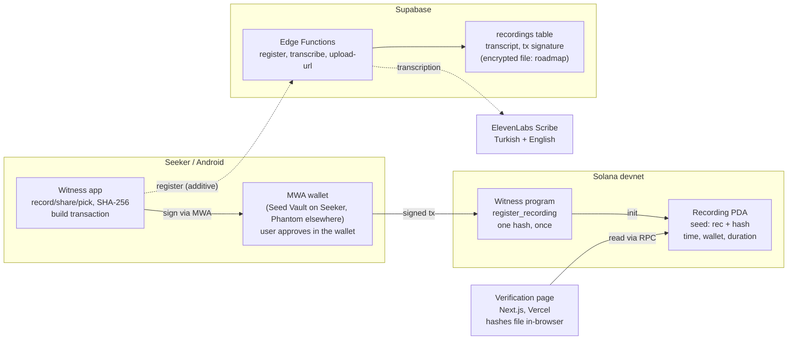
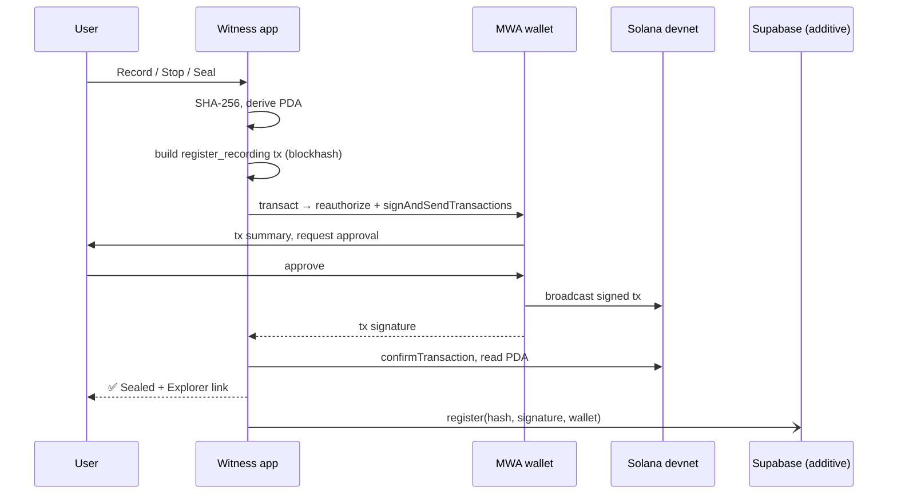
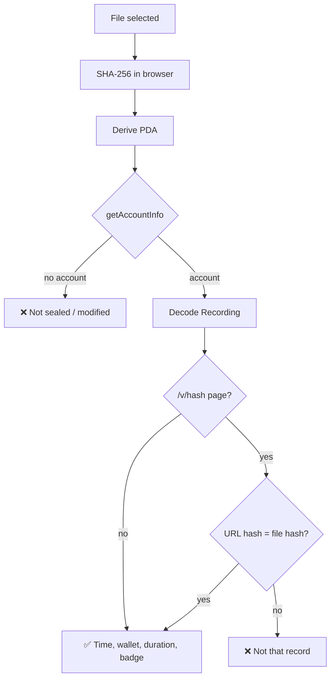

# Witness — Technical Documentation

Witness takes the SHA‑256 fingerprint of a file captured on a phone, has the user sign it through Mobile Wallet Adapter (Seed Vault on a Seeker, Phantom elsewhere; the app never holds a key), and writes a record to Solana. Anyone can then verify the file hasn't changed since that moment. This is the single technical source of truth for the system.

## What it proves

| Claim | Status | Backed by |
| --- | --- | --- |
| The file existed no later than now | Provable | Solana block time (`anchored_at`) |
| Not one byte has changed since | Provable | SHA‑256 match |
| This wallet sealed it | Provable | Ed25519 transaction signature |
| From a genuine Seeker device | 🔜 Planned | Seeker Genesis Token (SGT) check — not yet implemented |
| Captured at this location | 🔜 Planned, then claim only | Program has an optional `location_commitment`; the app does not fill it yet. Even then it is phone GPS, not cryptographic |
| The content is real | Not provable | A speaker can play fake audio into a mic. We claim "unaltered", not "true" |

**Core loop:** record/share/pick → hash → wallet approval (MWA) → write to chain → verification page ✅ / ❌. Everything else is additive: transcription is built; the share page, location commitment and encrypted sharing are on the roadmap.

## Architecture

Critical path: app → wallet → program → PDA ← verification page. Supabase and ElevenLabs (dashed) are additive; if they fail, the demo still works.



The verification page does not talk to Supabase at all: the ✅ / ❌ decision comes **only** from the on‑chain PDA.

## Mobile app & UI

Stack: React Native + Expo **dev build** (MWA does not work in Expo Go), Solana Mobile Expo template.

| Screen | Contents | MVP? |
| --- | --- | --- |
| Connect wallet | "Connect" button, shortened address (`7xKq…a9F2`), devnet badge, SOL balance, faucet hint if low | Yes |
| Record | Big record/stop button, timer, level meter, playback after stop, "Seal"/"Delete", location toggle (off by default; UI only for now, no commitment is computed yet) | Yes |
| Seal status | Step‑by‑step: Hash → Waiting for wallet approval → Writing to chain → ✅ Sealed. First 8 hex chars, Explorer link, Share. Error + Retry | Yes |
| My Recordings | Date, duration, status badge (Sealed / Pending / Error), first transcript line | Extra |
| Recording detail | Player, full hash (copy), tx signature, chain time, transcript, share link | Extra |

**User flow:** open → connect wallet once (MWA `authorize`, token cached) → record/stop/playback → Seal (app computes hash) → approval in the wallet (biometric on Seed Vault) → tx goes to devnet → Sealed screen with Explorer link + Share.

**Three entry points, one pipeline:** in‑app recording, OS share ("Share → Witness"), and the in‑app file picker ("Seal an existing file") all copy the file untouched and flow into the same `/seal` pipeline.

**UI rules:**

- After sealing, the app never re‑encodes, trims, or re‑tags the file. Playback and sharing use the same byte sequence.
- If writing to chain fails, the recording is not deleted — it stays "Pending" and can be retried.
- The Sealed screen shows without waiting for the transcript; the transcript is added when it arrives.

## Solana program

Written in Anchor, running on devnet. The program gives verification from the file alone, no double‑sealing of the same hash, and typed on‑chain data.

**Account `Recording`**, seeds `["rec", audio_hash]`:

```rust
#[account]
pub struct Recording {
    pub authority: Pubkey,                     // sealing wallet
    pub audio_hash: [u8; 32],                  // SHA-256 of the file
    pub recorded_at: i64,                       // phone time (claimed)
    pub anchored_at: i64,                        // Clock::get()?.unix_timestamp (the real proof)
    pub duration_ms: u32,
    pub location_commitment: Option<[u8; 32]>,  // sha256(lat|lon|salt), not raw coordinates
    pub bump: u8,
}
// size: 8 (discriminator) + 32 + 32 + 8 + 8 + 4 + 33 + 1 = 126 bytes
```

| Instruction | Caller | Effect | Failure |
| --- | --- | --- | --- |
| `register_recording(audio_hash, recorded_at, duration_ms, location_commitment)` | Sealing wallet (signer + payer) | `init`s the PDA, writes fields, takes `anchored_at` from the on‑chain clock, emits `RecordingRegistered` | PDA already exists → fails (no double‑seal). `duration_ms == 0` → `InvalidDuration` |

**Read side:** derive the PDA with `findProgramAddressSync([Buffer.from("rec"), hashBytes], PROGRAM_ID)`. No account → "not sealed"; present → decode with the Anchor coder.

**Deliberately omitted:** account close (proof can't be deleted), update instruction (immutability), admin key. Upgrade authority stays with the team on devnet; on mainnet the program would be immutable.

## Wallet integration (Mobile Wallet Adapter)

The app never touches the private key. It builds the transaction, sends it over Mobile Wallet Adapter to the wallet (Seed Vault on a Seeker, Phantom elsewhere), the user approves in the wallet (biometric on Seed Vault), and the wallet signs and broadcasts.



**Notes:**

- Packages: `@solana-mobile/mobile-wallet-adapter-protocol-web3js`, `@solana/web3.js`, `@coral-xyz/anchor` (instruction encoding).
- First connect: `authorize({ cluster: "devnet", identity: { name: "Witness", uri, icon } })`. The returned `auth_token` is cached; later seals use `reauthorize`, so the connect screen doesn't reappear.
- Separate approval per seal — a feature: each seal is a conscious consent.
- **MWA dApp identity:** wallets like Phantom verify the dApp over Android App Links. On an emulator this additionally requires the APK to carry a **v1 (JAR) signature** (Phantom reads the caller cert via the legacy path); AGP ignores `enableV1Signing` for `minSdk ≥ 24`, so the APK must be re‑signed with `apksigner … --v1-signing-enabled true --min-sdk-version 21`. The dApp `uri`, the domain's `assetlinks.json`, and the `autoVerify` intent‑filter must all stay consistent.
- Fallback: if a device is unavailable, Android emulator + Phantom/mock wallet.

## Hash, signature & encryption

Three distinct tools: SHA‑256 is a **hash** (one‑way, not encryption), Ed25519 is a **signature**, AES‑GCM is real **encryption**, designed for shared files (not yet implemented).

| Tool | For | Computed | Proves |
| --- | --- | --- | --- |
| SHA‑256 | File fingerprint | Phone (`expo-crypto`/`react-native-quick-crypto`) and browser (`crypto.subtle.digest`) | The file didn't change |
| Ed25519 signature | Sign the Solana tx | MWA wallet | This wallet sealed it |
| Solana block time | Timestamp | Chain (`Clock` sysvar) | Existed no later than this |
| SHA‑256 commitment | Hide location (planned) | Phone: `sha256(lat_e5 \| lon_e5 \| 16-byte salt)`; not computed yet, the app sends `null` | If revealed later, "they claimed this location then" |
| AES‑256‑GCM (planned) | Keep the shared file encrypted in Supabase | Encrypt on phone, decrypt in browser | The server can't read the file |

**Hash rule:** SHA‑256 of the file's final raw bytes, lowercase hex (64 chars). Written as 32 bytes on chain. The same file produces the same result on the phone, in the browser, and via `shasum -a 256`.

**End‑to‑end encrypted sharing (additive).** **Status: designed, not yet implemented.** The `upload-url` Edge Function and the private Storage bucket exist, but the app does not encrypt or upload files and the web has no `/v/` route yet.

1. The phone generates a random 256‑bit key and encrypts the file with AES‑256‑GCM.
2. Only the encrypted file is uploaded to Supabase Storage.
3. Share link: `/v/<hash>#k=<key base64url>`. Everything after `#` never leaves the browser, so Supabase and Vercel never see the key.
4. The verification page downloads the encrypted file, decrypts it in‑browser, hashes it, and compares to the chain.

The sealed hash is of the **unencrypted** original; encryption is only for transport and storage.

**Privacy:** only the hash, time, duration, and (optional) location commitment go on chain. Audio, transcript, and raw coordinates never do. By default audio stays only on the phone.

## Supabase

Not on the critical path: verification only reads the chain. Supabase holds the transcript and the hash → transaction mapping (and, once encrypted sharing ships, the encrypted file). **Even if Supabase is lost, no proof is lost.**

**Table `recordings`** (primary key `audio_hash`): `tx_signature`, `wallet`, `pda`, `duration_ms`, `anchored_at` (cache of chain time), `transcript`, `transcript_lang` (`tr`/`en`), `transcript_status` (`pending`/`done`/`failed`/`skipped`), `mime_type`, `storage_path` / `is_encrypted` (reserved for encrypted sharing, unused today), `has_genesis_token` (reserved, always false for now), `created_at`.

**Storage (reserved for encrypted sharing, roadmap):** private `recordings` bucket, path `<audio_hash>.m4a.enc` (same path for any type; the file is encrypted so the extension is meaningless, the real type is in `mime_type`). Reads via a 1‑hour signed URL; writes only through an Edge Function.

**Edge Functions:**

| Function | Input | Behavior |
| --- | --- | --- |
| `register` | `audio_hash`, `tx_signature`, `wallet`, `mime_type?` | Reads the tx from devnet, verifies it's confirmed and the PDA's hash/wallet match, then inserts the row. No fake record can be added |
| `transcribe` | `audio_hash` + audio/video file | Accepts audio/video only (photo/doc → 415, `skipped`). Sends to ElevenLabs Scribe, writes `transcript`. API key lives only here (Supabase secret) |
| `upload-url` | `audio_hash` | For a registered recording, returns a one‑time upload URL for the encrypted file. Deployed, but no client calls it yet |

**RLS:** anyone can read `recordings` (for the verification page), `anon` writes are off. All writes go through Edge Functions with the service role. No Sign‑In‑With‑Solana; `register`'s on‑chain check suffices for the hackathon.

Full API reference (request/response shapes, error codes): [`../supabase/README.md`](../supabase/README.md).

## Web verification page

Verification happens entirely in the browser. The file never goes to a server; the page reads directly from Solana RPC, so you don't have to trust us. Next.js + `@solana/web3.js`, deployed on Vercel.

**Pages:** `/` (drag & drop). Planned: `/v/<hash>` (share link; `#k=` auto‑downloads and decrypts, otherwise the user uploads the file). Step 5 and the `/v/hash` branch below describe that planned page.

**Steps:**

1. `file.arrayBuffer()` → `crypto.subtle.digest("SHA-256", buf)` → hex (streaming for > 64 MB).
2. PDA = `findProgramAddressSync(["rec", hash], PROGRAM_ID)`.
3. `getAccountInfo(pda)` → decode `Recording` with the Anchor coder.
4. No account → ❌; account present → ✅ with details.
5. On `/v/<hash>`, if the uploaded file's hash ≠ the URL hash → ❌ "not that record, trimmed or modified".



**Result screen:** a big green "identical to the sealed record" or red "never sealed / modified"; the anchored time (big) vs device time (small); shortened wallet + Explorer link; duration, tx link. Footer always: *"This page proves the content wasn't altered after sealing — not that it's true."*

## Interface contracts

| Topic | Rule |
| --- | --- |
| Hash | SHA‑256 of the file's final raw bytes, lowercase hex, 32 bytes on chain. Never re‑encoded after sealing |
| Audio format | m4a (AAC), mono, 44.1 kHz |
| Program | Devnet, `WITNESS_PROGRAM_ID` + `program/target/idl/witness.json`. PDA seeds `["rec", hash32]` |
| Package versions | `@coral-xyz/anchor` **0.31.x** (app + web, to read the program's IDL), `@solana/web3.js` **1.x**, Anchor CLI **0.31.x**, Node **20 LTS**. App: Expo **dev build**, not Expo Go |
| Time | Unix seconds (`i64`) on chain, local time in UI |
| Share link | `/v/<hash>` + optional `#k=<key>` (roadmap) |
| Secrets | ElevenLabs and Supabase service keys only in Supabase secrets; repo ships only `.env.example` |

## Threats & design decisions

| Risk | Mitigation |
| --- | --- |
| Phone hash ≠ browser hash | Cross‑check (phone / browser / `shasum`); the file never changes after sealing |
| Location left in the clear on chain | Off by default; only a commitment is ever written |
| Transcription exposes audio | Audio goes to ElevenLabs only for opt‑in transcription; stated in the pitch; only audio/video is ever sent |

**Closed decisions:** transcript hash is not written on chain (`attach_transcript` removed); location is never written in the clear; audio stays on the phone by default (encrypted sharing is on the roadmap); separate wallet approval per seal.

## Demo (~90 s)

1. Problem: "Today you can't prove whether a recording was trimmed after the fact."
2. Record 10 s (or pick a photo) → wallet approval → Sealed, Explorer link.
3. Transcript appears in the app.
4. Verification page: original file → ✅ match, time, wallet.
5. Trim one second / change one byte, re‑upload → ❌ no match.
6. Close: who it's for (journalists, tenants, harassment victims), why Seeker, what we don't claim.
