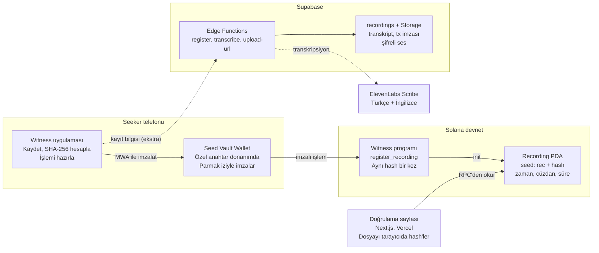
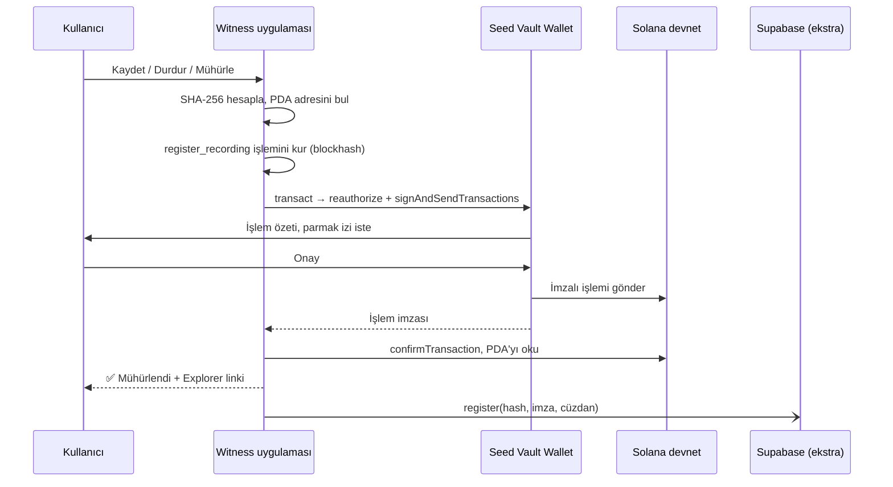
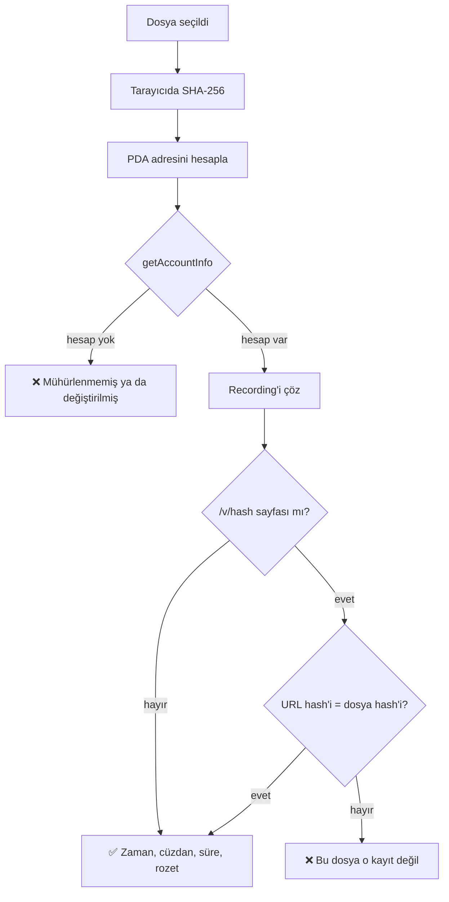
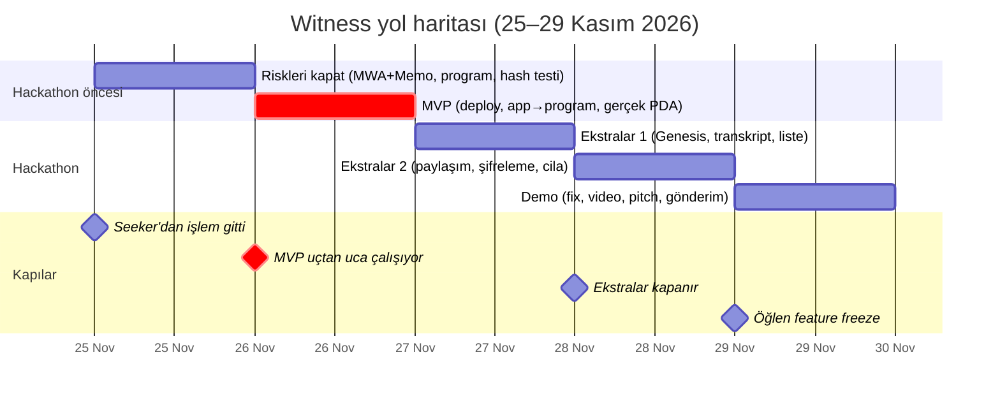

# Witness: Teknik Dokümantasyon

_Güncelleme: 25 Kasım 2026_

## Özet

Witness, Seeker'da alınan bir ses kaydının parmak izini (SHA-256) kullanıcının Seed Vault cüzdanıyla imzalayıp Solana'ya yazar. Böylece herkes kaydın o andan sonra değişmediğini doğrulayabilir. Önceden kod yazmak serbest olduğu için hedef şu: **MVP 26 Kasım akşamı çalışıyor olsun**, hackathon günleri (27–29 Kasım) ekstralara ve demoya kalsın.

| Kanıt | Durum | Neye dayanıyor |
| --- | --- | --- |
| Dosya en geç şu anda vardı | Kanıtlanır | Solana blok zamanı (`anchored_at`) |
| O andan beri tek bayt değişmedi | Kanıtlanır | SHA-256 eşleşmesi |
| Şu cüzdan kaydetti | Kanıtlanır | Ed25519 işlem imzası |
| Gerçek bir Seeker cihazından | Güçlü işaret | Cüzdanda Seeker Genesis Token var |
| Kayıt şu konumda alındı | Sadece beyan | Telefonun GPS'i, kriptografik değil |
| Kaydın içeriği gerçek | Kanıtlanmaz | Hoparlörden sahte ses çalınabilir. "Sonradan oynanmadı" diyoruz, "gerçek" demiyoruz |

**MVP:** kaydet → hash → Seed Vault onayı → zincire yaz → doğrulama sayfası ✅ / ❌. Bunun dışındaki her şey (transkript, paylaşım linki, Genesis rozeti, konum, ara hash) ekstradır.

## Mimari

Kritik yol: uygulama → Seed Vault → program → PDA ← doğrulama sayfası. Supabase ve ElevenLabs (kesikli oklar) ekstradır; düşerlerse demo yine çalışır.



Doğrulama sayfası transkripti ve şifreli dosyayı Supabase'den okur, ama ✅ / ❌ kararını sadece zincirdeki PDA'ya bakarak verir.

## Mobil uygulama ve UI

Uygulamada 5 ekran var; MVP için ilk üçü yeterli. Stack: React Native + Expo dev build (Expo Go'da MWA çalışmaz), Solana Mobile Expo şablonu.

| Ekran | Olması gerekenler | MVP mi? |
| --- | --- | --- |
| 1. Cüzdan bağla | "Cüzdanı bağla" butonu, bağlanınca kısaltılmış adres (`7xKq…a9F2`), devnet etiketi, SOL bakiyesi, bakiye düşükse faucet uyarısı | Evet |
| 2. Kayıt | Büyük kaydet / durdur butonu, süre sayacı, ses seviyesi göstergesi, durdurunca dinle butonu, "Mühürle" ve "Sil" butonları, konum anahtarı (varsayılan kapalı) | Evet |
| 3. Mühürleme durumu | Adım adım ilerleme: Hash hesaplanıyor → Cüzdan onayı bekleniyor → Zincire yazılıyor → ✅ Mühürlendi. Hash'in ilk 8 karakteri, Explorer linki, "Paylaş" butonu. Hata olursa sebebi ve "Tekrar dene" | Evet |
| 4. Kayıt listesi | Her satırda tarih, süre, durum rozeti (Mühürlendi / Bekliyor / Hata), transkriptin ilk satırı | Ekstra |
| 5. Kayıt detayı | Oynatıcı, tam hash (kopyala), işlem imzası, zincir zamanı, transkript, paylaşım linki, Seeker rozeti | Ekstra |

**Kullanıcı akışı:**

1. Uygulamayı aç → cüzdanı bir kez bağla (MWA `authorize`, auth token saklanır)
2. Kaydet → Durdur → dinle
3. Mühürle → uygulama hash'i hesaplar
4. Seed Vault onayı (parmak izi / çift dokunma) → işlem devnet'e gider
5. Mühürlendi ekranı → Explorer linki, paylaşım linki

**UI kuralları:**

- Dosya mühürlendikten sonra uygulama onu asla yeniden kodlamaz, kırpmaz, metadata eklemez. Oynatma ve paylaşım aynı bayt dizisini kullanır.
- Zincire yazma başarısız olursa kayıt silinmez, "Bekliyor" durumunda kalır ve tekrar denenebilir.
- Transkript gelmesini beklemeden Mühürlendi ekranı gösterilir; transkript gelince ekrana eklenir.

## Solana programı (akıllı sözleşme)

Programın tek işi, her ses hash'i için bir kez yazılabilen ve hash'ten bulunabilen bir kayıt hesabı açmak. Anchor ile yazılır, devnet'te çalışır. Kanıt program olmadan da mümkün (Memo); program şu üç şeyi ekliyor: sadece dosyayla doğrulama, aynı hash'in ikinci kez yazılamaması ve tipli veri.

**Hesap: `Recording`**, seed'ler `["rec", audio_hash]`

```rust
#[account]
pub struct Recording {
    pub authority: Pubkey,                        // kaydeden cüzdan
    pub audio_hash: [u8; 32],                     // dosyanın SHA-256'sı
    pub recorded_at: i64,                         // telefon saati (beyan)
    pub anchored_at: i64,                         // Clock::get()?.unix_timestamp (asıl kanıt)
    pub duration_ms: u32,
    pub location_commitment: Option<[u8; 32]>,    // sha256(lat|lon|salt), açık koordinat değil
    pub bump: u8,
}
// boyut: 8 (discriminator) + 32 + 32 + 8 + 8 + 4 + 33 + 1 = 126 bayt
```

**Instruction'lar**

| Instruction | Kim çağırır | Ne yapar | Hata durumları |
| --- | --- | --- | --- |
| `register_recording(audio_hash, recorded_at, duration_ms, location_commitment)` | Kaydeden cüzdan (signer + payer) | PDA'yı `init` ile açar, alanları yazar, `anchored_at`'i zincir saatinden alır, `RecordingRegistered` event'i yayar | PDA zaten varsa işlem başarısız (aynı hash ikinci kez yazılamaz). `duration_ms == 0` ise `InvalidDuration` |
| ~~`attach_transcript(transcript_hash)`~~ | — | **Yazılmıyor.** Kullanıcıdan ikinci bir parmak izi isterdi. Transkript Supabase'de durur | — |

**Okuma tarafı (web ve uygulama):** PDA adresi `PublicKey.findProgramAddressSync([Buffer.from("rec"), hashBytes], PROGRAM_ID)` ile hesaplanır. Hesap yoksa "Bu dosya mühürlenmemiş" denir, varsa Anchor coder ile çözülür.

**Yedek plan: SPL Memo.** Program 26 Kasım öğlene kadar deploy edilemezse uygulama işlemi Memo programına `witness:v1:<hash hex>` metniyle gönderir. Bu durumda doğrulama için işlem imzası gerekir; hash → imza eşleşmesini Supabase tutar ve paylaşım linkine `?tx=` olarak eklenir.

**Bilerek yapılmayanlar:** hesap kapatma (kanıt silinemesin), güncelleme instruction'ı (değişmezlik), admin anahtarı. Upgrade authority devnet'te ekipte kalır; pitch'te "mainnet'te immutable yaparız" denir.

## Cüzdan entegrasyonu (MWA + Seed Vault)

Uygulama özel anahtara hiç dokunmaz. İşlemi hazırlar, Mobile Wallet Adapter ile Seed Vault Wallet'a gönderir, kullanıcı parmak iziyle onaylar, cüzdan imzalayıp ağa yollar.



**Teknik notlar:**

- Paketler: `@solana-mobile/mobile-wallet-adapter-protocol-web3js`, `@solana/web3.js`, `@coral-xyz/anchor` (instruction kodlama için)
- İlk bağlantıda `authorize({ cluster: "devnet", identity: { name: "Witness", uri, icon } })`. Dönen `auth_token` saklanır, sonraki kayıtlarda `reauthorize` ile bağlanma ekranı tekrar çıkmaz.
- Her kayıt için ayrı onay gerekir. Bu bir özellik: her mühür kullanıcının bilinçli onayı.
- Seed Vault SDK'ya doğrudan erişim sadece cüzdan uygulamalarına açık; biz yalnızca MWA kullanıyoruz.
- **Seeker Genesis Token rozeti** (ekstra): cüzdanın token hesapları okunur, Genesis Token mint'i varsa rozet gösterilir. Ek imza yok. Mint adresi Solana Mobile dokümanından teyit edilecek.
- Test yedeği: Seeker erişilemezse Android emülatör + mock wallet.

## Hash, imza ve şifreleme

Üç farklı araç var: SHA-256 bir **hash**'tir (şifreleme değil, geri çevrilemez), Ed25519 bir **imza**dır, AES-GCM ise gerçek **şifreleme**dir ve sadece paylaşılan dosya için kullanılır.

| Araç | Ne için | Nerede hesaplanır | Kanıtladığı |
| --- | --- | --- | --- |
| SHA-256 | Ses dosyasının parmak izi | Telefonda (`expo-crypto` / `react-native-quick-crypto`) ve tarayıcıda (`crypto.subtle.digest`) | Dosya değişmedi |
| Ed25519 imza | Solana işlemini imzalamak | Seed Vault (güvenli donanım) | Şu cüzdan kaydetti |
| Solana blok zamanı | Zaman damgası | Zincir (`Clock` sysvar) | En geç bu anda vardı |
| SHA-256 commitment | Konumu gizlemek | Telefonda: `sha256(lat_e5 \| lon_e5 \| 16 bayt rastgele salt)` | Konum sonradan açıklanırsa "bu konumu o zaman beyan etmişti" |
| AES-256-GCM | Paylaşılan ses dosyasını Supabase'de şifreli tutmak (ekstra) | Telefonda şifrelenir, tarayıcıda çözülür | Sunucu dosyayı dinleyemez |

**Hash kuralı:** dosyanın son halinin ham baytlarının SHA-256'sı, küçük harf hex (64 karakter). Zincire 32 bayt olarak yazılır. Aynı dosya telefonda, tarayıcıda ve `shasum -a 256` ile aynı sonucu vermeli.

**Paylaşım için uçtan uca şifreleme (ekstra):**

1. Telefon rastgele 256 bitlik bir anahtar üretir, dosyayı AES-256-GCM ile şifreler
2. Sadece şifreli dosya Supabase Storage'a yüklenir
3. Paylaşım linki: `/v/<hash>#k=<anahtar base64url>`. `#` sonrası tarayıcıdan sunucuya hiç gitmez, yani Supabase ve Vercel anahtarı görmez
4. Doğrulama sayfası şifreli dosyayı indirir, anahtarla tarayıcıda çözer, hash'ler, zincirle karşılaştırır

Mühürlenen hash **şifrelenmemiş** orijinal dosyanındır; şifreleme sadece taşıma ve saklama içindir.

**Gizlilik:** zincire sadece hash, zaman, süre ve (isteğe bağlı) konum commitment'ı yazılır. Ses, transkript ve açık koordinat asla zincire gitmez. Varsayılan olarak ses sadece telefonda kalır.

## Supabase

Supabase MVP'nin kritik yolunda değil: doğrulama sadece zincire bakar. Supabase transkripti, paylaşılan dosyayı ve hash → işlem eşleşmesini tutar. **Supabase kaybolsa bile hiçbir kanıt kaybolmaz.**

**Tablo: `recordings`**

| Kolon | Tip | Not |
| --- | --- | --- |
| `audio_hash` | `text` primary key | 64 karakter küçük harf hex |
| `tx_signature` | `text` not null | Mühürleme işlemi |
| `wallet` | `text` not null | Base58 cüzdan adresi |
| `pda` | `text` | Memo yedeğinde boş |
| `duration_ms` | `int` | Fotoğraf gibi süresiz dosyalarda `1` (program `> 0` istiyor); sadece ses/videoda gösterilir |
| `anchored_at` | `timestamptz` | Zincirden okunan zaman, önbellek |
| `transcript` | `text` | ElevenLabs çıktısı |
| `transcript_lang` | `text` | `tr`, `en` |
| `transcript_status` | `text` | `pending` / `done` / `failed` / `skipped` (ses/video değil, transkript yapılmaz) |
| `mime_type` | `text` | Dosya türü (`audio/mp4`, `image/jpeg`…). Uygulama `register`'da gönderir; doğrulama sayfası çözülen dosyayı buna göre gösterir. Boşsa ses varsayılır |
| `storage_path` | `text` | Sadece kullanıcı paylaştıysa |
| `is_encrypted` | `bool` default `true` | |
| `has_genesis_token` | `bool` | Rozet önbelleği |
| `created_at` | `timestamptz` default `now()` | |

**Storage:** `recordings` bucket'ı, private. Yol `<audio_hash>.m4a.enc` (her dosya türü için aynı yol; dosya şifreli olduğu için uzantının anlamı yok, gerçek tür `mime_type`'ta). Okuma imzalı URL ile (1 saat), yazma sadece Edge Function üzerinden.

**Edge Function'lar:**

| Fonksiyon | Girdi | Ne yapar |
| --- | --- | --- |
| `register` | `audio_hash`, `tx_signature`, `wallet`, `mime_type` (isteğe bağlı) | İşlemi devnet'ten okur, onaylı olduğunu ve PDA'daki hash/cüzdanın eşleştiğini kontrol eder, sonra satırı ekler. Sahte kayıt eklenemez |
| `transcribe` | `audio_hash` + ses/video dosyası | Sadece ses ve video kabul eder (foto, belge → `415`, `skipped`). ElevenLabs Scribe'a gönderir, `transcript`'i yazar. API anahtarı sadece burada (Supabase secret) durur |
| `upload-url` | `audio_hash` | Kayıt `register` edilmişse şifreli dosya için tek seferlik yükleme URL'si verir |

**Güvenlik (RLS):** `recordings` tablosunda herkes okuyabilir (doğrulama sayfası için), `anon` rolüyle yazma kapalı. Tüm yazmalar service role ile Edge Function'lardan yapılır. Cüzdanla giriş (Sign-In With Solana) yok; hackathon için `register`'ın zincir kontrolü yeterli.

**Transkript akışı:** mühürleme bitince uygulama `transcribe`'ı arka planda çağırır, sonucu beklemez. Ses dosyası transkripsiyon için ElevenLabs'e gider; pitch'te bu açıkça söylenir ve transkript ayarı kapatılabilir olur.

## Web doğrulama sayfası

Doğrulama tamamen tarayıcıda olur. Dosya sunucuya gitmez, sayfa doğrudan Solana RPC'den okur, bu yüzden bize güvenmek gerekmez. Next.js + `@solana/web3.js`, Vercel'e deploy.

**Sayfalar:**

- `/` : dosya sürükle bırak alanı, "Dosya bilgisayarınızdan çıkmaz" notu
- `/v/<hash>` : paylaşım linki. Hash üstte görünür, zincir kaydı hemen yüklenir. `#k=` varsa şifreli dosya indirilip otomatik doğrulanır; yoksa kullanıcı dosyayı kendisi yükler

**Doğrulama adımları:**

1. `file.arrayBuffer()` → `crypto.subtle.digest("SHA-256", buf)` → hex
2. PDA = `findProgramAddressSync(["rec", hash], PROGRAM_ID)`
3. `connection.getAccountInfo(pda)` → Anchor coder ile `Recording`'i çöz
4. Hesap yok → ❌, hesap var → ✅ ve detaylar
5. `/v/<hash>` sayfasında yüklenen dosyanın hash'i URL'deki hash'ten farklıysa → ❌ "Bu dosya o kayıt değil, kesilmiş ya da değiştirilmiş"



**Sonuç ekranında olması gerekenler:**

| Alan | ✅ Eşleşti | ❌ Eşleşmedi |
| --- | --- | --- |
| Büyük durum | Yeşil "Bu dosya mühürlü kayıtla birebir aynı" | Kırmızı "Bu dosya hiç mühürlenmemiş ya da değiştirilmiş" |
| Zaman | "En geç şu anda vardı": `anchored_at`, büyük; cihaz saati küçük | — |
| Cüzdan | Kısaltılmış adres + Explorer linki, Seeker rozeti (varsa) | — |
| Kayıt | Süre, işlem imzası linki, transkript (varsa) | Beklenen ve hesaplanan hash yan yana (paylaşım linkinde) |
| Dipnot | "Bu sayfa içeriğin doğru olduğunu değil, sonradan değiştirilmediğini kanıtlar" | — |

**Memo yedeğinde:** `/v/<hash>?tx=<imza>` ile gelinir; sayfa `getTransaction` ile memo metnini okuyup hash'i karşılaştırır, zaman için `blockTime`'ı kullanır.

## Roller: kim ne yapıyor

Her parçanın tek bir sahibi var. Rust/Solana bilen 3'ü, en tecrübeli React Native'ci 2'yi, ikinci React Native'ci 1'i, web'ci 4'ü, en iyi anlatan 5'i alsın. Oturma düzeni: 1+2 yan yana, 3+4 yan yana, 5 ortada.

| Rol | Teslim ettiği | Kimi bekler / kim onu bekler |
| --- | --- | --- |
| 1. Mobil UI | 5 ekran, ses formatı (m4a/AAC, 44.1 kHz, mono), son dosya yolu, demo ekran kaydı | 2'ye dosyayı verir |
| 2. Mobil cüzdan + entegrasyon | MWA bağlantısı, hash, işlem oluşturma ve imzalatma, Genesis rozeti, APK, Seeker cihazı | 1'den dosyayı, 3'ten IDL'ı bekler |
| 3. Solana programı | Anchor programı, testler, devnet deploy, program ID + IDL, Memo yedeği, README | 2 ve 4 onun IDL'ını bekler |
| 4. Web doğrulama | Next.js sayfası, `/v/<hash>`, şifreli dosya çözme, Vercel deploy, slayt görselleri | 3'ten IDL'ı bekler (o zamana kadar sahte veri) |
| 5. Backend + AI + kaptan | Supabase tablo/bucket/RLS, `register` / `transcribe` / `upload-url`, check-in'ler, mentor/jüri iletişimi, pitch, demo videosu, gönderim | Kimseyi bloklamaz; kritik yolda değil |

**Ortak sorumluluklar:**

- Hash çapraz testi: 1 + 4 (aynı dosya telefonda, tarayıcıda ve `shasum`'da aynı hash'i verecek)
- `Recording` hesap yapısının donması: 3 yazar, 2 ve 4 onaylar
- Demo provası: herkes, 29 Kasım öğleden sonra

## Yol haritası

Önceden kod yazmak serbest olduğu için bütün riskli işler hackathon öncesine çekildi.



| Rol | 25 Kas | 26 Kas | 27 Kas | 28 Kas | 29 Kas |
| --- | --- | --- | --- | --- | --- |
| 1. Mobil UI | Kayıt ekranı, m4a çıktısı | Cüzdan bağla + Mühürleme durumu | Kayıt listesi, transkript görünümü | Kayıt detayı, UI cilası | Hata düzeltme, demo ekran kaydı |
| 2. Cüzdan + entegrasyon | **İlk iş:** MWA ile Memo işlemi; SHA-256 | IDL'dan `register_recording`, PDA okuma | Genesis rozeti, `register` çağrısı | Şifreleme + yükleme | Son APK |
| 3. Solana programı | `register_recording` + testler, devnet deploy | IDL'ı paylaş, destek, Memo yedeği | PDA / Memo okumada destek | README, repo | Program ID, gönderim |
| 4. Web doğrulama | Next.js iskeleti, tarayıcıda hash, sahte veri | Gerçek PDA ile ✅ / ❌, Vercel | `/v/<hash>` | Şifreli dosya çözme, transkript | Slayt görselleri |
| 5. Backend + kaptan | Repo + kurallar, Supabase, ElevenLabs denemesi | `register` + `transcribe` | Transkripti bağla, check-in'ler | `upload-url`, pitch taslağı | Pitch + video, sunum, gönderim |

**Karar noktaları:**

- 25 Kasım akşamı Seeker'dan devnet'e işlem gitmediyse → 26 Kasım sabahı herkes 2'ye destek, emülatör yedeği devreye girer
- 26 Kasım öğlen program deploy edilmediyse → Memo ile devam, program 27 Kasım'a kalır
- 26 Kasım akşamı MVP uçtan uca çalışmıyorsa → 27 Kasım'da ekstra yok, sadece MVP
- 29 Kasım öğlen → feature freeze

## Ortak kurallar ve arayüz sözleşmeleri

| Konu | Kural |
| --- | --- |
| Hash | Dosyanın son halinin ham baytlarının SHA-256'sı. Metinde küçük harf hex, zincirde 32 bayt. Dosya sonradan yeniden kodlanmaz |
| Ses formatı | m4a (AAC), mono, 44.1 kHz |
| Program | Devnet, `PROGRAM_ID` + `program/target/idl/witness.json`. PDA seed'leri `["rec", hash32]` |
| Paket sürümleri | `@coral-xyz/anchor` **0.31.x** (app + web, programın ürettiği IDL'ı okuyabilmek için aynı major/minor; Anchor 0.30+ IDL formatı eskisiyle uyumsuz). `@solana/web3.js` **1.x** (v2 kullanılmaz, API farklı). Anchor CLI **0.31.x**, Node **20 LTS**. App: Expo **dev build**, Expo Go değil |
| Zaman | Zincirde Unix saniye (`i64`), UI'da İstanbul saati |
| Supabase tablosu | `recordings` (yukarıdaki kolonlar) |
| Paylaşım linki | `/v/<hash>` + isteğe bağlı `#k=<anahtar>`, Memo yedeğinde `?tx=<imza>` |
| Memo formatı | `witness:v1:<hash hex>` |
| Repo | Tek repo, public: `/app`, `/program`, `/web`, `/supabase`, `/docs` |
| Branch | Herkes kendi klasöründe, `main`'e küçük ve sık PR. Ortak dosyalar (IDL, `.env.example`) sadece sahibi tarafından değiştirilir |
| Gizli anahtarlar | ElevenLabs ve Supabase service key sadece Supabase secrets'ta. Repo'da sadece `.env.example` |
| Check-in | Günde 3 kez 10 dk (sabah, öğle, akşam): ne bitti, ne takıldı, kim kimi bekliyor |

## Riskler, açık kararlar ve demo

| Risk | Etki | Önlem |
| --- | --- | --- |
| MWA / Seed Vault ile işlem gönderilemiyor | Her şey | 25 Kasım ilk iş Memo testi; olmazsa emülatör + mock wallet |
| Telefondaki hash ile tarayıcıdaki hash farklı | Demo ❌ verir | Hash çapraz testi; dosya mühürden sonra hiç değişmez |
| Anchor deploy gecikir | Program yok | Memo yedeği |
| Expo + MWA kurulumu zaman yer | Gecikme | Solana Mobile Expo şablonundan başla |
| Devnet yavaş / faucet limiti | İşlem düşer | Her cüzdana yeterli devnet SOL; yedek RPC |
| ElevenLabs gecikmesi | Transkript geç gelir | Asenkron; demo kaydı önceden test edilir |
| Konumun zincirde açık kalması | Mağdurlar için tehlike | Varsayılan kapalı, sadece commitment |

**Kapanan kararlar:**

- Transkript hash'i zincire yazılmıyor, `attach_transcript` yok
- Konum zincire açık yazılmıyor
- Ses varsayılan olarak telefonda kalıyor, paylaşılırsa şifreli yükleniyor
- Her kayıt için ayrı cüzdan onayı

**Hâlâ açık:**

- [ ] Rollere isim atanması
- [ ] Türkiye local track var mı (Telegram)
- [ ] Seeker Genesis Token mint adresi
- [ ] Önceden yazılan kodun jüriye beyan edilmesi gerekiyor mu

**Demo senaryosu (~90 sn):**

1. Problem: "Bir ses kaydının sonradan kesilip kesilmediğini bugün kanıtlayamazsınız."
2. Seeker'da 10 sn kayıt → parmak iziyle onay → Mühürlendi, Explorer linki
3. Transkript ekranda belirir
4. Doğrulama sayfası: orijinal dosya → ✅ Eşleşti, zaman, cüzdan, Seeker rozeti
5. Audacity'de bir saniye kes, tekrar yükle → ❌ Eşleşmedi
6. Kapanış: kimler için (gazeteciler, kiracılar, taciz mağdurları), neden Seeker, neyi kanıtlamıyoruz
